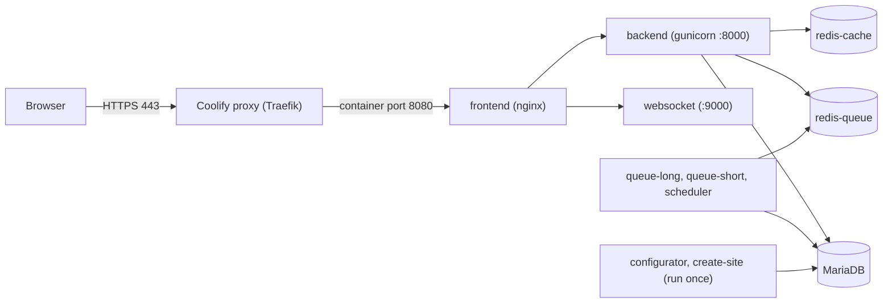

# ERP Suite for Coolify

A reproducible way to self-host **ERPNext together with Frappe HR, CRM, Helpdesk and Insights on a single site**,
deployed with [Coolify](https://coolify.io). You build one pinned container image, then deploy it with a
Coolify-ready Docker Compose file. No SSH sessions are needed for day-to-day operation.

> **Status: beta.** See [Project status](#project-status). Please test on a throwaway site before using it
> for real company data.

> **Disclaimer.** This is an independent community project. It is not affiliated with or endorsed by Frappe
> Technologies. ERPNext, Frappe and related names belong to their respective owners.

## What you get

- A custom image containing the apps below, built by GitHub Actions and published to GitHub Container Registry.
- A `compose.yaml` that sets up the database, Redis, workers, scheduler, websocket and the nginx frontend,
  with health checks and generated passwords.
- The site is created automatically on first start and the chosen apps are installed on it.
- Documentation for deployment, email, backups and troubleshooting.

### Apps in the image

| App | Branch | Notes |
|---|---|---|
| Frappe Framework | `v16.51.1` (build input) | Pinned; change it deliberately. |
| Payments | `version-16` | ERPNext dependency. |
| ERPNext | `version-16` | |
| HR (HRMS) | `version-16` | |
| Telephony | `develop` | Prerequisite for CRM and Helpdesk. |
| CRM | `main` | No `version-16` branch exists. |
| Helpdesk | `main` | Needs a compatible Frappe version. See [troubleshooting](docs/troubleshooting.md). |
| Insights | `version-3` | |

Branches are floating, so **the image tag is the pin**. Test a tag, then deploy that exact tag.

## Architecture

## Quick start

1. **Build the image.** Add this repo to GitHub, then run **Actions, Build ERP suite image** with a new tag
   such as `2026-10-24`. Make the resulting package public (or configure registry credentials in Coolify).
2. **Create a DNS A record** for your hostname pointing at your Coolify server.
3. **Deploy** `compose.yaml` as a *Docker Compose Empty* resource in Coolify and set the variables below.
4. **Set the domain** of the `frontend` service to `https://<SITE_NAME>:8080`. The `:8080` only selects
   the container port to proxy to; users still visit the plain HTTPS address.
5. **Log in** as `Administrator`. The password is the generated `SERVICE_PASSWORD_ADMIN` value.

Full walkthrough: [docs/deploy-coolify.md](docs/deploy-coolify.md).

## Configuration

| Variable | Required | Description |
|---|---|---|
| `SITE_NAME` | yes | Hostname users browse to, for example `erp.example.com`. No scheme, no port. |
| `ERPNEXT_IMAGE` | yes | Image without tag, for example `ghcr.io/digitalterrene/erp-suite` (lowercase). |
| `ERPNEXT_TAG` | yes | The tag you built and tested. Do not use `latest`. |
| `INSTALL_APPS` | no | Apps installed when the site is first created. Default: `hrms telephony crm helpdesk insights`. |
| `SERVICE_PASSWORD_DBROOT` | generated | Database root password, generated by Coolify. |
| `SERVICE_PASSWORD_ADMIN` | generated | Initial `Administrator` password, generated by Coolify. |

## Email

Outgoing email (password resets, notifications) must be configured after the first login. The guide covers
using your own domain's SMTP server, including cPanel hosting: [docs/email.md](docs/email.md).

## Security

- No database or Redis ports are published. Only the frontend is reachable, through the Coolify proxy over HTTPS.
- Passwords are generated, not hard-coded. Never commit `.env` files or credentials.
- Enable two-factor authentication for administrators in ERPNext.
- Keep Coolify, the host OS and your image tag up to date, and test backups. See [docs/backups.md](docs/backups.md).
- Report vulnerabilities privately. See [SECURITY.md](SECURITY.md).

## Project status

| Area | Status |
|---|---|
| Image build in GitHub Actions | Verified by the maintainer |
| Deployment on Coolify with all apps | Pending verification |
| Email via SMTP | Pending verification |
| Backup and restore procedure | Pending verification |
| In-place upgrade procedure | Not yet documented. Do not upgrade an existing site by changing the tag until this exists. |

## Roadmap and help wanted

- Documented, tested upgrade procedure for existing sites.
- Automated smoke test in CI that boots the stack.
- Backup automation with off-server copies, and a scripted restore test.
- Image vulnerability scanning and SBOM publishing.
- MariaDB and gunicorn tuning guidance by server size.
- Guides for other deployment targets.

See [CONTRIBUTING.md](CONTRIBUTING.md) to get involved.

## Licensing

The files in this repository are released under the [MIT License](LICENSE).

The built image bundles third-party applications that have **their own licenses**, which this project does not
change. Check each upstream repository's `LICENSE` before you publish or redistribute an image. This is not
legal advice.
